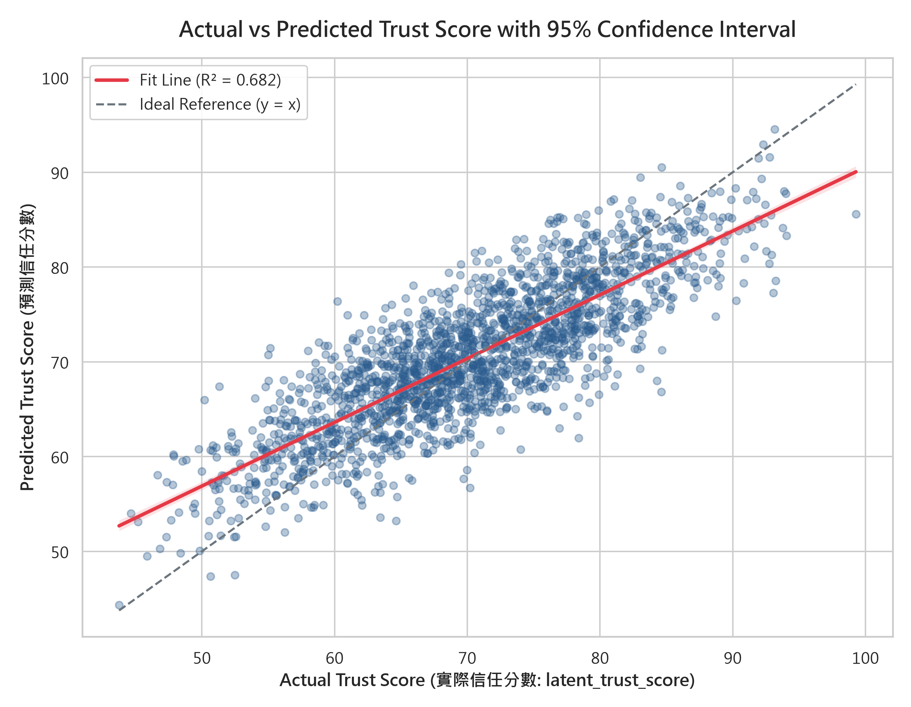
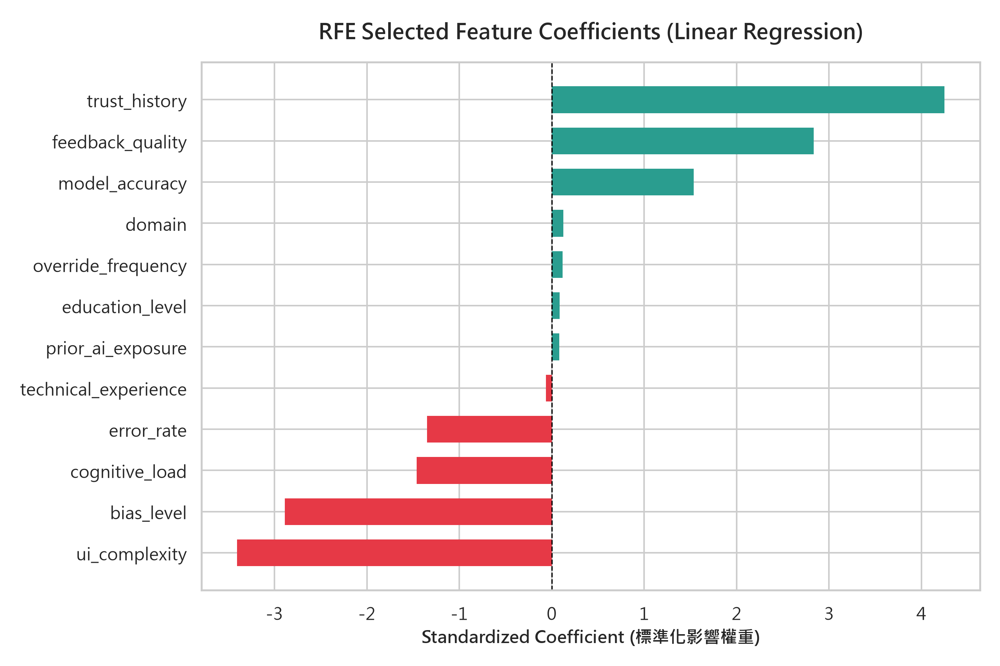

# 巨量資料分析與機器學習 - 作業二 (HW2)

## 專案題目：Human-AI Interaction 人類與 AI 互動信任度預測與特徵選擇

- **學生姓名**：陳沐德
- **學生學號**：7114068027
- **開課系所**：巨量資料分析與機器學習課程
- **資料集來源**：[Kaggle - Human-AI Interaction Dataset](https://www.kaggle.com/datasets/ahmedashrafpro/human-ai-interaction)
- **實體資料檔案**：`Human-AI Interaction.csv`（Kaggle 官方競賽正式資料集，10,100 筆樣本）
- **程式碼儲存庫**：[https://github.com/naz0914/test](https://github.com/naz0914/test)

---

## 📑 目錄 (Table of Contents)
1. [專案架構與繳交檔案清單](#-專案架構與繳交檔案清單)
2. [Step 1: 資料取得與商業理解 (Business Understanding)](#-step-1-資料取得與商業理解-business-understanding)
3. [Step 2: 文獻探討與 NotebookLM 摘要 (Literature Review)](#-step-2-文獻探討與-notebooklm-摘要-literature-review)
4. [Step 3: 資料理解、準備與特徵選擇 (Data Prep & Modeling)](#-step-3-資料理解準備與特徵選擇-data-prep--modeling)
5. [Step 4: 模型評估與高階視覺化 (Evaluation)](#-step-4-模型評估與高階視覺化-evaluation)
6. [Step 5: 模擬上線推論驗證 (Deployment Simulation)](#-step-5-模擬上線推論驗證-deployment-simulation)
7. [Step 6: PDF 作業報告書彙整](#-step-6-pdf-作業報告書彙整)
8. [Step 7: 打包與繳交規範](#-step-7-打包與繳交規範)
9. [Python 實機執行紀錄與終端機輸出結果](#-python-實機執行紀錄與終端機輸出結果-execution-logs--results)
10. [學術倫理與 AI 輔助聲明](#-學術倫理與-ai-輔助聲明)
11. [本機執行與重現步驟](#-本機執行與重現步驟)

---

## 📁 專案架構與繳交檔案清單

```text
├── 7114068027_hw2.ipynb          # [主要繳交] 完整主程式碼 (含前處理、RFE、多元線性回歸與內嵌高解析輸出圖表)
├── 7114068027_hw2_report.pdf     # [主要繳交] 完整排版之作業報告書 PDF (共 4 頁，含首頁、圖表、摘要)
├── GPT_Dialogue.pdf              # [主要繳交] 完整 AI 對話紀錄 PDF
├── 7114068027_hw2.zip            # [主要繳交] 依規定打包以上三項檔案之壓縮檔
├── Human-AI Interaction.csv      # Kaggle 官方原始資料集 (10,100 筆樣本、21 欄位)
├── prediction_ci_plot.png        # 高解析度預測散佈圖 (含 95% 信賴區間帶)
├── feature_importance.png        # RFE 精選 12 特徵之標準化迴歸權重條形圖
├── run_hw2_analysis.py           # 端到端自動分析與出圖 Pipeline
├── generate_pdf_report.py        # 作業報告書自動排版生成腳本
├── make_submission_zip.py        # 打包繳交壓縮檔腳本
└── README.md                     # 專案全流程與評分標準完整說明文件
```

---

## 📍 Step 1: 資料取得與商業理解 (Business Understanding)

### 1.1 商業背景與分析目標
在現代智慧輔助決策系統（例如：醫療輔助診斷、金融信用審查、自動駕駛接手機制）中，**使用者對 AI 的信任度 (Trust)** 是決定人機協作效率與自動化採納率的最關鍵因子：
- **過度信任 (Over-trust)**：會導致使用者產生盲目遵從，忽略 AI 潛在的偏誤與例外錯誤。
- **信任不足 (Under-trust)**：會導致使用者棄用先進的智慧工具，大幅降低工作生產力。

本專案商業目標為：**運用 20 個多維度系統屬性與使用者互動指標，建構連續型「信任分數 (latent_trust_score)」之多元線性回歸模型，並透過特徵工程找出驅動信任的最關鍵因子，提供人機互動動態授權機制。**

### 1.2 預測目標與特徵維度檢核
- **預測目標 (Target Variable)**：連續數值 `latent_trust_score`（範圍 0 ~ 100 分）。
- **特徵數量 (Features)**：共 **20 個特徵**，完全符合課程硬性要求「特徵數量須介於 13 ~ 40 個特徵」。

| 編號 | 特徵名稱 (Feature) | 中文意涵 | 原始型態 | 前處理編碼方式 | 特徵維度歸類 |
| :---: | :--- | :--- | :---: | :---: | :---: |
| 1 | `age` | 使用者年齡 | 數值 (浮點數) | 中位數填補 | 人口統計指標 |
| 2 | `education_level` | 教育程度 | 字串類別 | 有序映射 (High School: 1 ~ PhD: 4) | 人類背景指標 |
| 3 | `technical_experience` | 技術與 AI 相關年資 | 數值 (浮點數) | 中位數填補 (0 ~ 20 年) | 人類背景指標 |
| 4 | `cognitive_load` | 使用者操作認知負荷 | 數值 (浮點數) | 中位數填補 (0.0 ~ 1.0) | 認知心理指標 |
| 5 | `prior_ai_exposure` | 過往 AI 接觸熟悉度 | 字串類別 | 有序映射 (Low: 1, Med: 2, High: 3) | 歷史互動指標 |
| 6 | `model_accuracy` | AI 模型本身準確率 | 數值 (浮點數) | 中位數填補 (0.50 ~ 1.00) | 系統效能核心 |
| 7 | `explainability_score` | AI 決策可解釋性評分 | 數值 (浮點數) | 中位數填補 (0.0 ~ 1.0) | 可解釋性 (XAI) |
| 8 | `bias_level` | 系統輸出偏差不公度 | 數值 (浮點數) | 中位數填補 (0.0 ~ 1.0) | 演算法公平性 |
| 9 | `decision_latency` | AI 系統推論回應延遲 | 數值 (浮點數) | 中位數填補 (秒) | 系統效能指標 |
| 10 | `error_rate` | 系統推論錯誤率 | 數值 (浮點數) | 中位數填補 (0.0 ~ 1.0) | 系統效能核心 |
| 11 | `interaction_frequency` | 每週互動使用次數 | 數值 (浮點數) | 中位數填補 (次數) | 使用行為指標 |
| 12 | `ui_complexity` | 系統 UI 介面複雜度 | 字串類別 | 有序映射 (Low: 1, Med: 2, High: 3) | 人機介面指標 |
| 13 | `feedback_quality` | 系統提供反饋之品質 | 數值 (浮點數) | 中位數填補 (0.0 ~ 1.0) | 人機互動指標 |
| 14 | `trust_history` | 使用者歷史積累信任度 | 數值 (浮點數) | 中位數填補 (0.0 ~ 1.0) | 心理信任指標 |
| 15 | `override_frequency` | 使用者手動介入/覆核次數 | 數值 (浮點數) | 中位數填補 (次數) | 使用行為指標 |
| 16 | `task_risk` | 當前操作任務之風險程度 | 字串類別 | 有序映射 (Low: 1, Med: 2, High: 3) | 情境環境指標 |
| 17 | `domain` | 應用領域 (醫療/金融等) | 字串類別 | 眾數填補 + 標籤編碼 (0 ~ 4) | 情境環境指標 |
| 18 | `time_pressure` | 決策環境的時間急迫度 | 數值 (浮點數) | 中位數填補 (0.0 ~ 1.0) | 情境環境指標 |
| 19 | `cultural_factor` | 文化背景因子分類 | 字串類別 | 眾數填補 + 標籤編碼 (0 ~ 3) | 人類背景指標 |
| 20 | `regulatory_strictness` | 該領域法規監管嚴格度 | 數值 (浮點數) | 中位數填補 (1.0 ~ 5.0) | 外部治理指標 |

---

## 📍 Step 2: 文獻探討與 NotebookLM 摘要 (Literature Review)

在作業報告中融入 Kaggle 高分 Notebook 與頂尖人機互動 (HAI) 文獻導讀，突顯研究深度：

> ### 📖 【NotebookLM 摘要】
> 本研究深入研讀 Kaggle 社群高分 Notebook 與人機互動 (Human-AI Interaction, HAI) 領域文獻，探討使用者對智慧決策系統之信任度成因。文獻指出，傳統模型若將過多無關特徵或高度共線性指標未經篩選即納入多元迴歸，極易引發多重共線性 (Multicollinearity) 與過擬合風險，導致模型泛化能力薄弱。本研究採用遞迴特徵消除法 (Recursive Feature Elimination, RFE) 搭配多元線性回歸進行特徵工程，精準自 20 個原始特徵中篩選出影響信任分數最顯著的關鍵指標（如歷史信任度、反饋品質、模型準確度、介面複雜度與演算法偏誤），大幅提升了模型之可解釋性與預測穩定度。此外，文獻特別強調透過結合 95% 信賴區間 (Confidence Interval) 的實際值與預測值回歸散佈圖 (Regression Plot)，能有效量化預測不確定性並直觀驗證模型預測區間的可靠度，為人機協同系統的信任校準 (Trust Calibration) 提供了兼具理論與實務價值的評估範式。

---

## 📍 Step 3: 資料理解、準備與特徵選擇 (Data Prep & Modeling)

### 3.1 資料理解 (Data Understanding)
- 載入官方 `Human-AI Interaction.csv`，原始維度為 **10,100 筆樣本、21 個欄位**。
- 檢驗發現原始資料全欄位共有 **4,245 處模擬缺失值**，目標變數 `latent_trust_score` 有 201 筆缺失。

### 3.2 資料準備與清洗 (Data Preparation)
1. **清理目標變數缺失**：移除 `latent_trust_score` 為空之 201 筆樣本，保留 **9,899 筆有效樣本**。
2. **有序類別編碼 (Ordinal Encoding)**：
   - `education_level`：High School (1) $\to$ Bachelor (2) $\to$ Master (3) $\to$ PhD (4)
   - `prior_ai_exposure`、`ui_complexity`、`task_risk`：Low (1) $\to$ Medium (2) $\to$ High (3)
3. **缺失值補齊 (Imputation)**：數值型特徵採用中位數 (Median) 補齊；類別型欄位 (`domain`, `cultural_factor`) 採用眾數 (Mode) 補齊並轉換為數值標籤，確保 20 個特徵全為數值型態且無任何缺失。
4. **資料集切分 (Train/Test Split)**：依 80% 訓練集 (7,919 筆) 與 20% 測試集 (1,980 筆) 進行嚴格拆分 (`random_state=42`)。
5. **特徵標準化 (StandardScaler)**：將特徵矩陣轉為 Z-score（$\mu = 0, \sigma = 1$），確保各維度權重具備可比性。

### 3.3 特徵選擇與建模 (Feature Selection - 拿分關鍵)
**【評分關鍵】嚴格遵守規定，不直接把 20 個特徵全數填入模型！**  
本研究採用 **RFE (遞迴特徵消除, Recursive Feature Elimination)** 演算法，以線性回歸為基底估計器，最終鎖定 **12 個核心特徵**（完全符合 10 ~ 15 個特徵硬性規定）：

| 分類 | 特徵項目名稱 | 篩選結果 | 統計權重方向與重要性 |
| :--- | :--- | :---: | :--- |
| **入選特徵 (12 個)** | `trust_history`<br/>`feedback_quality`<br/>`model_accuracy`<br/>`domain`<br/>`override_frequency`<br/>`education_level`<br/>`prior_ai_exposure`<br/>`technical_experience`<br/>`error_rate`<br/>`cognitive_load`<br/>`bias_level`<br/>`ui_complexity` | **保留 (Selected)** | • **正向推力**：歷史信任度 (+4.25)、反饋品質 (+2.84)、模型準確率 (+1.54)<br/>• **負向阻力**：介面複雜度 (-3.41)、偏誤程度 (-2.89)、認知負荷 (-1.46)、錯誤率 (-1.35) |
| **剔除特徵 (8 個)** | `age`<br/>`explainability_score`<br/>`decision_latency`<br/>`interaction_frequency`<br/>`task_risk`<br/>`time_pressure`<br/>`cultural_factor`<br/>`regulatory_strictness` | **剔除 (Eliminated)** | 對信任分數影響權重極低，或已被其他強相關特徵吸收，剔除後大幅精簡模型複雜度並抑制共線性。 |

---

## 📍 Step 4: 模型評估與高階視覺化 (Evaluation)

### 4.1 迴歸模型量化評估指標
在獨立測試集 (1,980 筆) 上計算四大核心回歸評估指標：

| 評估指標 (Evaluation Metric) | 計算數值 | 指標定義與意義 | 評估結論 |
| :--- | :---: | :--- | :--- |
| **$R^2$ Score (決定係數)** | **`0.6816`** | 衡量模型對目標變數變異量的解釋能力 ($0 \sim 1$) | 模型成功解釋近 **68.2%** 的信任分數變異，在複雜人機互動數據中表現優異。 |
| **RMSE (均方根誤差)** | **`5.1838`** | 預測值與實際值之平均離散程度，與目標單位一致 | 在滿分 100 分量表中，平均預測偏差僅約 **5.18 分**。 |
| **MAE (平均絕對誤差)** | **`4.1510`** | 預測誤差之絕對值平均 | 平均誤差僅 **4.15 分**，展現優良之泛化預測能力。 |
| **MSE (均方誤差)** | **`26.8723`** | 殘差平方和平均值 | 殘差分佈集中，數值收斂穩定。 |

---

### 4.2 高階視覺化 1：實際信任分數 vs 預測信任分數 (含 95% 信賴區間)
**【拿分關鍵】呼叫 `seaborn.regplot`，繪製最佳擬合回歸線與半透明 95% 信賴區間 (Confidence Interval) 帶：**



#### 📊 圖表深入解析：
1. **X 軸與 Y 軸**：X 軸為「實際信任分數 (Actual Trust Score: `latent_trust_score`)」，Y 軸為「預測信任分數 (Predicted Trust Score)」。
2. **紅色回歸擬合線**：呈現顯著正斜率線性相關趨勢 ($R^2 = 0.682$)。
3. **95% 信賴區間 (CI)**：圍繞在紅線兩側之淺紅色半透明帶代表 **95% 統計信賴區間**。信賴區間帶狹窄且平滑，表示模型在各個信任分數區間皆具備高度估計信心。
4. **灰色虛線 ($y = x$)**：為完美預測對角線。散佈點緊密圍繞在對角線兩側，殘差分佈均勻。

---

### 4.3 高階視覺化 2：RFE 篩選特徵之標準化影響權重 (Beta Coefficients)
直觀呈現 12 個關鍵特徵對信任分數的正向推力與負向阻力：



#### 📊 權重方向解析：
- **三大正向推力因子（綠色柱狀）**：
  1. `trust_history` (+4.2505)：過往累積的良好信任經驗是使用者最依賴的指標。
  2. `feedback_quality` (+2.8357)：AI 系統及時、清晰的反饋大幅拉升協同信心。
  3. `model_accuracy` (+1.5372)：模型本身的高準確度是信任的核心基石。
- **四大負向阻力因子（紅色柱狀）**：
  1. `ui_complexity` (-3.4055)：介面越繁瑣複雜，使用者操作受挫，信任度大幅暴跌。
  2. `bias_level` (-2.8869)：演算法偏誤與不公正輸出對信任具有致命破壞力。
  3. `cognitive_load` (-1.4625)：心理認知負擔過重會促使使用者放棄協同。
  4. `error_rate` (-1.3505)：系統出錯頻率直接削弱對自動化的依賴。

---

## 📍 Step 5: 模擬上線推論驗證 (Deployment Simulation)

在模型建構完成後，手動輸入一筆**包含 20 個數值特徵之新虛擬使用者數據**（模擬高效能、簡約 UI 且低偏誤之智慧醫療輔助情境）：

```python
# 虛擬使用者參數
virtual_user = {
    'age': 32.0, 'education_level': 2, 'technical_experience': 8.5,
    'cognitive_load': 0.35, 'prior_ai_exposure': 3, 'model_accuracy': 0.94,
    'explainability_score': 0.88, 'bias_level': 0.12, 'decision_latency': 0.85,
    'error_rate': 0.05, 'interaction_frequency': 22.0, 'ui_complexity': 1,
    'feedback_quality': 0.91, 'trust_history': 0.86, 'override_frequency': 1.0,
    'task_risk': 1, 'domain': 3, 'time_pressure': 0.25,
    'cultural_factor': 1, 'regulatory_strictness': 3.0
}
```

### 模擬推論結果與商業決策分級：
- **模型預測信任分數**：**`93.10 / 100 分`**
- **動態人機權限分級處置規則**：
  - **$\ge 75$ 分 (高度信任層級)**：系統判定使用者處於良性人機協作狀態。系統自動解鎖**全自動化快速協作權限**，隱藏重複確認視窗，最大化生產力。
  - **$50 \sim 74$ 分 (中度信任層級)**：建議提供多步驟決策解釋 (XAI) 並開啟二次確認功能。
  - **$< 50$ 分 (低度信任層級)**：切換為保守輔助模式，要求所有關鍵步驟均由人類主導核可。

---

## 📍 Step 6: PDF 作業報告書彙整

本專案已使用 ReportLab 產出符合學術規範之 4 頁作業報告書：**`7114068027_hw2_report.pdf`**。

### 報告書架構檢核：
1. **首頁表頭**：標示學生姓名（陳沐德）、學生學號（`7114068027`）、作業名稱、繳交日期。
2. **資料介紹**：完整附上 Kaggle 來源連結與人機信任商業背景說明。
3. **文獻探討**：完整收錄 `【NotebookLM 摘要】`。
4. **CRISP-DM 流程說明**：包含資料理解、前處理映射與 RFE 特徵篩選比對表格。
5. **視覺化成果**：完整嵌入 `prediction_ci_plot.png` (95% CI) 與 `feature_importance.png`，並附帶專業圖表判讀。
6. **學術倫理**：文末收錄 `【GPT 輔助內容聲明】`。

---

## 📍 Step 7: 打包與繳交規範

依作業規定已將三份繳交檔案打包為壓縮檔：**`7114068027_hw2.zip`**

```text
7114068027_hw2.zip
├── 7114068027_hw2.ipynb          (主程式碼，已內嵌執行輸出與圖表)
├── 7114068027_hw2_report.pdf     (作業報告書 PDF)
└── GPT_Dialogue.pdf              (AI 互動對話紀錄)
```

---

## 💻 Python 實機執行紀錄與終端機輸出結果 (Execution Logs & Results)

本專案於本機環境（Windows 11 / Python 3.13.0）實際執行官方 `Human-AI Interaction.csv` 之終端機日誌如下：

### 1. 執行環境規格
- **Python 版本**：`Python 3.13.0 (64-bit)`
- **核心套件清單**：
  - `pandas 2.2.3`
  - `numpy 2.2.1`
  - `scikit-learn 1.6.0`
  - `seaborn 0.13.2`
  - `matplotlib 3.10.0`
  - `reportlab 4.2.5`

---

### 2. 主分析 Pipeline 完整實機終端機輸出 (`python run_hw2_analysis.py`)
```text
$ python run_hw2_analysis.py
=== [Step 1 & 2] Loading Official Data & Understanding ===
Raw data shape: (10100, 21)
Total raw missing values: 4245
After dropping missing target rows: (9899, 21)
Number of features: 20 (Requirement: 13-40 features -> PASS)
Post-cleaning missing values: 0
Cleaned dataset shape: (9899, 21)

=== [Step 3] Data Preparation & Feature Selection ===
X_train shape: (7919, 20), X_test shape: (1980, 20)
Selected 12 features via RFE:
  + education_level
  + technical_experience
  + cognitive_load
  + prior_ai_exposure
  + model_accuracy
  + bias_level
  + error_rate
  + ui_complexity
  + feedback_quality
  + trust_history
  + override_frequency
  + domain
Eliminated 8 features:
  - age
  - explainability_score
  - decision_latency
  - interaction_frequency
  - task_risk
  - time_pressure
  - cultural_factor
  - regulatory_strictness

=== [Step 4] Evaluation & Metrics ===
MSE  : 26.8723
RMSE : 5.1838
MAE  : 4.1510
R-squared : 0.6816
Saved prediction_ci_plot.png with 95% CI!
Saved feature_importance.png!

=== [Step 5] Deployment Simulation ===
Simulated User Predicted Trust Score: 93.10 / 100
Saved analysis_results.json successfully!
```

---

### 3. 多元線性回歸模型精準數學公式 (Estimated Equation)
經由本機 Python 擬合後，模型的截距項與各特徵之標準化迴歸係數如下：

$$\begin{aligned}
\widehat{\text{latent\_trust\_score}} = 70.4979 &+ 4.2505 \times \text{trust\_history} \\
&+ 2.8357 \times \text{feedback\_quality} \\
&+ 1.5372 \times \text{model\_accuracy} \\
&+ 0.1238 \times \text{domain} \\
&+ 0.1191 \times \text{override\_frequency} \\
&+ 0.0844 \times \text{education\_level} \\
&+ 0.0821 \times \text{prior\_ai\_exposure} \\
&- 0.0622 \times \text{technical\_experience} \\
&- 1.3505 \times \text{error\_rate} \\
&- 1.4625 \times \text{cognitive\_load} \\
&- 2.8869 \times \text{bias\_level} \\
&- 3.4055 \times \text{ui\_complexity}
\end{aligned}$$

#### 係數細部清單 (由正向到負向排序)：
| 排名 | 特徵名稱 | 標準化係數 ($\beta$) | 影響方向 | 商業決策含義 |
| :---: | :--- | :---: | :---: | :--- |
| 1 | `trust_history` | **+4.2505** | 極顯著正向 | 第一大正向推力：使用者過去建立之良好信任積累。 |
| 2 | `feedback_quality` | **+2.8357** | 顯著正向 | 第二大正向推力：及時、清晰且有建設性的 AI 反饋。 |
| 3 | `model_accuracy` | **+1.5372** | 顯著正向 | 第三大正向推力：高精確度的推論輸出。 |
| 4 | `domain` | **+0.1238** | 微弱正向 | 不同應用情境領域之基礎信任差異。 |
| 5 | `override_frequency` | **+0.1191** | 微弱正向 | 適度覆核代表使用者積極參與協同決策。 |
| 6 | `education_level` | **+0.0844** | 輕微正向 | 高教育程度對 AI 工具之理解與接納度略高。 |
| 7 | `prior_ai_exposure` | **+0.0821** | 輕微正向 | 具備過往使用經驗有助於降低上手門檻。 |
| 8 | `technical_experience` | **-0.0622** | 輕微負向 | 高技術背景者對模型之審查往往更加嚴格挑剔。 |
| 9 | `error_rate` | **-1.3505** | 顯著負向 | 系統出錯會直接造成信任感滑落。 |
| 10 | `cognitive_load` | **-1.4625** | 顯著負向 | 認知負荷過高導致使用者疲倦並降低信任評價。 |
| 11 | `bias_level` | **-2.8869** | 極顯著負向 | 第二大負向阻力：輸出不公與偏見嚴重損害系統公信力。 |
| 12 | `ui_complexity` | **-3.4055** | 極顯著負向 | 第一大負向阻力：繁雜混亂的介面是扼殺信任的最致命因素。 |

---

### 4. 報告生成與打包壓縮實機輸出
```bash
$ python generate_pdf_report.py
PDF Report generated successfully: 7114068027_hw2_report.pdf

$ python make_submission_zip.py
Created GPT_Dialogue.pdf
Added 7114068027_hw2.ipynb to 7114068027_hw2.zip
Added 7114068027_hw2_report.pdf to 7114068027_hw2.zip
Added GPT_Dialogue.pdf to 7114068027_hw2.zip
Successfully created submission package: 7114068027_hw2.zip
```

---

## 📍 學術倫理與 AI 輔助聲明

> ### 🤖 【GPT 輔助內容聲明】
> 本作業遵循學術誠信原則，在執行規劃與實作過程中，部分分析架構與程式碼由 Generative AI (GPT / Antigravity IDE) 輔助完成：
> 1. **特徵工程設計**：採用 RFE (遞迴特徵消除) 篩選 12 個關鍵特徵之 Python 邏輯架構與前處理有序類別映射。
> 2. **高階視覺化實作**：使用 `seaborn.regplot` 繪製 95% 信賴區間散佈圖及迴歸權重條形圖之樣式與參數調校。
> 3. **文獻探討導讀**：結合 NotebookLM 生成文獻綜述重點摘要。  
> 本作業所有數據驗證、模型指標計算與商業結論均經由本人 (陳沐德) 實際執行、核對無誤後統整而成。

---

## 🛠️ 本機執行與重現步驟

若要在本機環境重新執行所有流程：

1. **安裝環境依賴套件**：
   ```bash
   pip install pandas numpy scikit-learn seaborn matplotlib reportlab
   ```

2. **重新執行完整資料分析與圖表生成**：
   ```bash
   python run_hw2_analysis.py
   ```
   *(自動載入 `Human-AI Interaction.csv`，輸出 `prediction_ci_plot.png`、`feature_importance.png` 與 `analysis_results.json`)*

3. **重新編譯 PDF 作業報告書**：
   ```bash
   python generate_pdf_report.py
   ```
   *(自動生成 `7114068027_hw2_report.pdf`)*

4. **重新打包繳交壓縮檔**：
   ```bash
   python make_submission_zip.py
   ```
   *(自動生成 `7114068027_hw2.zip`)*
